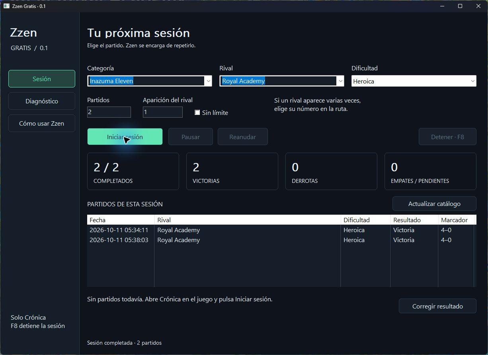

# Zzen · Free

A native C++ desktop app for repeating **Chronicle matches** in Inazuma Eleven: Victory Road with Commander mode and Rematch.

> **The game must be set to Spanish.** Changing Zzen's display language does not change this requirement. Recognition is designed for the Spanish game interface.

**[Download for Windows](https://github.com/kazah-png/Zzen/releases/latest)**



## Features

- Match selection by category, opponent, occurrence and difficulty.
- A fixed match count or unlimited repetition.
- An initial catalog of 131 entries across eight categories, refreshable from the game.
- Start, pause, resume and **F8** to stop.
- Session results and win/loss counters.
- Diagnostics with screenshots, recognized text and recent actions.
- Spanish, English, Japanese, Simplified Chinese, French and Hindi display languages.

Free keeps results only for the current session. Item recognition and persistent reward tracking belong to the separate Premium edition.

## Getting started

1. Download the Windows x64 ZIP and **extract the entire folder**.
2. Open `Zzen.exe`. No installation, account or activation key is needed.
3. **Set the game to Spanish**, use keyboard/mouse controls and open a **Chronicle** route.
4. Choose the opponent, difficulty and match count. **Occurrence** distinguishes repeated opponents.
5. Select **Start session**. Zzen finds the opponent, enables Commander and repeats with Rematch.

Keep the game visible and focused. Switching windows pauses Zzen; **Resume** continues. **F8** stops it. Only one Zzen edition can run at a time.

## App language versus game language

Use the top-right language selector: **Español, English, 日本語, 简体中文, Français or हिन्दी**. Your choice is saved immediately.

Opponent names, catalog entries and raw OCR evidence remain in Spanish, as read from the game. **The required game language is always Spanish**, regardless of the app language.

## Requirements and limitations

Windows x64 with Windows text recognition available. Spanish game UI with keyboard/mouse controls; visual reference **1920 × 1080**, 16:9. Required difficulties must be unlocked in your save. The catalog does not unlock matches.

Recognition may need adjustment when the game interface or layout changes. See [validation and limitations](docs/VALIDATION.md).

Zzen uses screenshots and normal Windows input. It does not modify game files, inject code, read process memory or alter anti-cheat. This is an unofficial project, not affiliated with LEVEL5.

## Troubleshooting

Open **Diagnostics**. **Observe game** analyzes the screen without sending inputs. **Save diagnostics** saves the capture and activity log locally.

An unreadable score is marked **Pending** and pauses progress. Review the evidence before using **Review result**. It is never assumed to be a win. Free results reset on a new session or when closing the app.

## Local data

There are no accounts or telemetry. Files stay beside the executable.

| Folder | Contents |
|---|---|
| `data` | Settings, catalog and activity log |
| `debug` | Diagnostics explicitly saved by the user |
| `captures` | Evidence for unreadable results |
| `evidence` | Captures from catalog scanning |

JSON writes are atomic and keep a `.bak` backup. Generated data is excluded from this repository. Review captures before sharing them in an issue.

## Build and test

Install Visual Studio Build Tools with **Desktop development with C++**, a Windows SDK with C++/WinRT, and PowerShell.

```powershell
./build.ps1 -Test
```

This builds `dist/Zzen/Zzen.exe` and runs classification, storage, localization and engine tests. Engine tests replace input injection with in-memory events and **do not control the game**.

`CMakeLists.txt` is also provided for MSVC. Local visual tests require private game captures, which are not included:

```powershell
./tests/visual.ps1 -Fixtures C:/path/to/test-captures
```

## Source layout

`core.hpp`: classification; `vision.hpp`: capture and OCR; `zzen.cpp`: engine; `catalog_engine.inc`: navigation; `storage.hpp`: settings; `ui.hpp`: Win32 interface; `i18n.hpp`: display languages.
